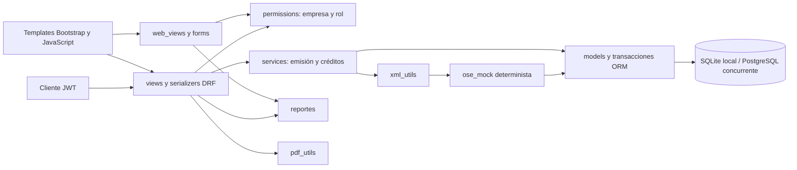
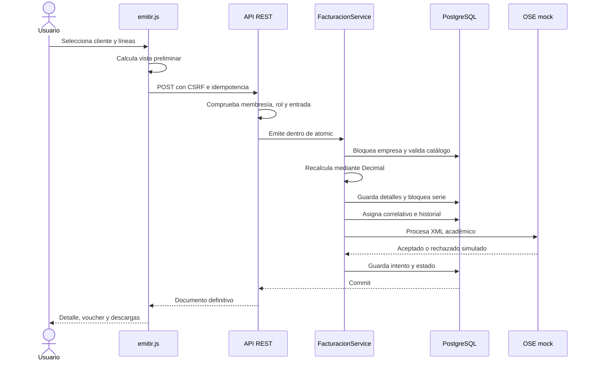

# Arquitectura

Se conserva la aplicación `facturacion` y la configuración `FacturacionSunat`. La arquitectura corresponde a Django con una capa de servicios; no utiliza una arquitectura hexagonal ni repositorios artificiales.

`models.py` define integridad, identidad y snapshots. `services.py` centraliza cálculos decimales, reservas de saldo, numeración y transiciones. `serializers.py` valida entradas REST y transforma resultados. `views.py` maneja HTTP y filtros. `permissions.py` resuelve el ámbito exclusivamente a partir de permisos comprobados. `signals.py` protege el contenido emitido frente a cambios y borrados por ORM ordinario. `reportes.py` comparte las filas de JSON, HTML, CSV y Excel. `web_views.py` renderiza consultas y formularios; la emisión dinámica usa los mismos endpoints que integradores externos.

Todo el procesamiento mock pertenece a la transacción: no hay efectos de red que puedan quedar fuera de un rollback. Una integración real requeriría una cola/outbox y reconciliación; no se implementan porque no se solicitan envíos reales. Los imports locales de XML/OSE en servicios evitan ciclos con los modelos y mantienen el punto de entrada existente `FacturacionService`.
