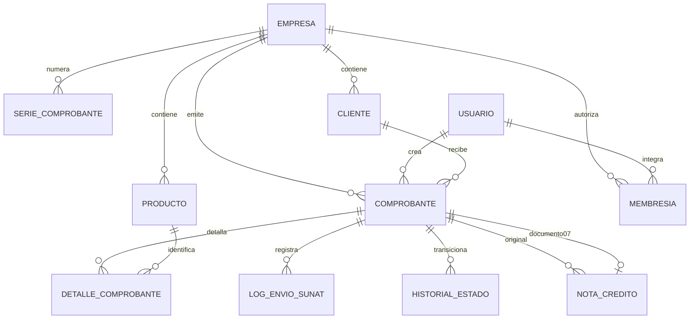

# Modelo de datos

| Entidad | Atributos y restricciones |
|---|---|
| Empresa | RUC único de 11 dígitos, razón social, nombre comercial, dirección y régimen |
| SerieComprobante | Empresa, tipo F/B/FC, serie de cuatro caracteres, contador positivo; única por empresa/tipo/serie |
| Cliente | Empresa, RUC/DNI/CE, número, razón social, dirección, email, activo; documento único por empresa/tipo |
| Producto | Empresa, código único por empresa, descripción, unidad, precio Decimal(12,2) no negativo, afecto IGV y activo |
| Comprobante | Empresa, tipo 01/03/07, serie, número nullable en borrador, fecha, cliente, creador, subtotal/IGV/total Decimal(12,2), estado, XML, snapshots e idempotencia |
| DetalleComprobante | Documento, producto, cantidad positiva, precio, descuento, IGV y subtotal Decimal(12,2); descripción, unidad y afectación histórica |
| LogEnvioSUNAT | Documento protegido, fecha, estado de respuesta, código y descripción mock |
| NotaCredito | Original protegido, documento 07 uno a uno, motivo, tipo, monto positivo Decimal(12,2), fecha |
| Membresia | Usuario, empresa, rol ADMIN/EMISOR/CONTADOR y activo; única por usuario/empresa |
| HistorialEstado | Documento protegido, estado anterior/nuevo, fecha y actor |

La numeración es única por empresa/tipo/serie/número; las claves idempotentes son únicas por empresa. La base de datos comprueba importes no negativos, coherencia número/estado y suma base más IGV mediante redondeo de dos decimales compatible con SQLite. Hay índices para empresa/fecha/estado y empresa/tipo.

Los FK de clientes, productos, empresa, notas, logs y estados preservan evidencia mediante `PROTECT` donde corresponde. Las líneas dependen del documento, pero las señales rechazan modificaciones de líneas emitidas. La administración permite inspeccionar documentos y logs sin editarlos. Los catálogos se desactivan desde la aplicación para preservar relaciones.

`datos_historicos` copia RUC, documento, razón social y dirección de emisor/receptor al crear la venta. Los detalles copian descripción/unidad/afectación; PDF, XML, voucher y reportes usan estas copias. Cambiar un nombre de catálogo no reescribe documentos anteriores.

Campos empresariales nullable y vínculos de crédito nullable se mantienen para compatibilidad con datos previos. Las nuevas operaciones exigen empresa y generan siempre documento 07. Los registros antiguos sin empresa no se exponen en la API ni web de usuarios.
