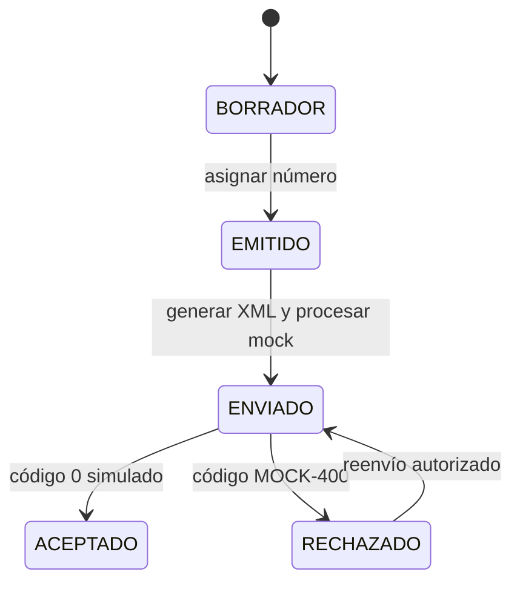
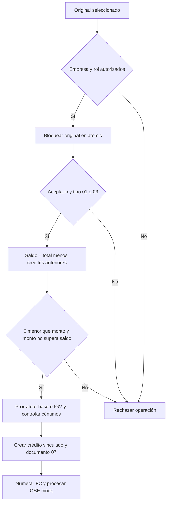

# Reglas de negocio

## Importes y documentos

Los precios del proyecto original incluyen IGV. Se mantiene esta convención en catálogo, formulario, API y servicios. El descuento es un importe total por línea, no un porcentaje.

1. Convertir entradas a `Decimal` y rechazar no finitos, cantidad no positiva, precio/descuento negativos o descuento superior a cantidad por precio.
2. Redondear `cantidad × precio − descuento` a dos decimales, `ROUND_HALF_UP`.
3. Gravado: base igual al total dividido entre `1.18`, redondeada por línea; IGV igual al total menos esa base. No gravado: base igual al total e IGV cero.
4. Sumar las bases y los impuestos por línea. El backend ignora los totales enviados por clientes HTTP.

Ejemplo: dos unidades de S/ 118,00 con descuento de S/ 11,80 producen total S/ 224,20, base S/ 190,00 e IGV S/ 34,20. `subtotal` incluye bases gravadas y no gravadas. El navegador muestra ambas por separado; no sustituye el cálculo definitivo.

Factura 01 exige receptor RUC numérico de 11 dígitos. Boleta 03 permite DNI de 8 dígitos; CE admite entre 6 y 15 caracteres alfanuméricos. No se consulta la existencia del documento en organismos externos.

## Numeración

`emitir_comprobante` bloquea la empresa para serializar solicitudes idempotentes. `_numerar` bloquea la serie correspondiente y actualiza contador/documento en la misma transacción. Las series son independientes por empresa y tipo; puede seleccionarse una serie concreta. No se modifica un contador desde API ni desde el formulario administrativo.

El borrador se guarda sin número. Al emitirlo se fija la fecha efectiva de emisión. Cualquier fallo anterior al commit revierte contador, líneas, historial y documento. Un rechazo OSE es un resultado de una emisión válida, por lo que **sí conserva su correlativo**. Un reenvío usa ese mismo correlativo.

La garantía concurrente requiere PostgreSQL. Las pruebas `test_concurrencia.py` abren conexiones independientes y sincronizan cinco emisores para detectar duplicados y saltos.

## Estados y auditoría

Cada transición registra fecha y usuario. Aceptado es terminal. Las interfaces no permiten PATCH/DELETE de comprobantes; las señales impiden editar su contenido y el admin ofrece solo consulta. El bloqueo ORM complementa FK protegidos; operaciones SQL directas realizadas por un administrador de base de datos son externas al control de la aplicación.

## Notas de crédito

Motivos tipificados disponibles: 01, 02, 03, 06 y 07 con descripción libre obligatoria. El ejercicio registra el monto monetario indicado; no implementa todas las validaciones específicas del catálogo SUNAT real para cada motivo. Los créditos no modifican líneas ni importes del original. Sus impuestos se prorratean y limitan al remanente original; la última nota absorbe diferencias de céntimos. Los créditos rechazados reservan saldo porque son reenviables; solo los aceptados restan en reportes.

La UI genera una clave idempotente por intento de formulario y deshabilita envíos simultáneos. Integradores deben enviar una clave estable por operación lógica para obtener protección frente a reintentos de red.
